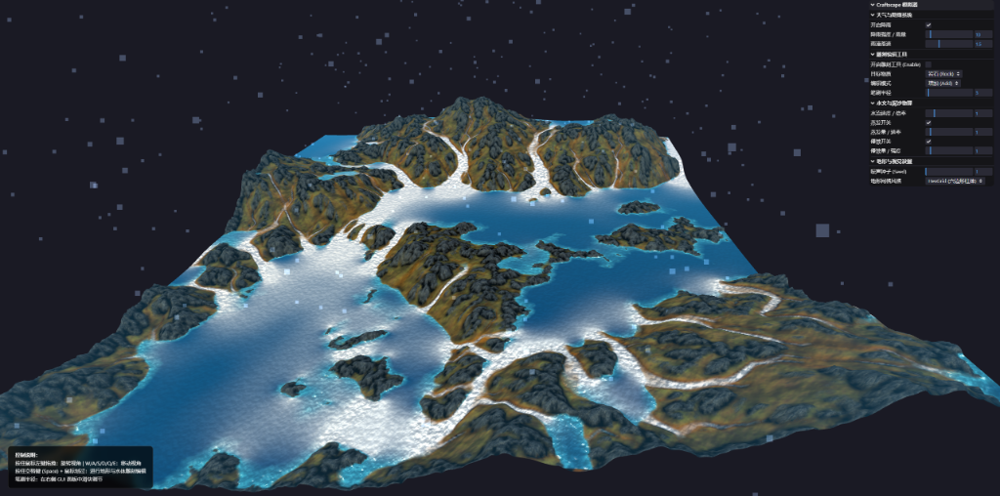

# Craftscape Three.js 🌊⛰️

English | [简体中文](./README.zh-CN.md)

> A modern, high-customizability 3D terrain sculpting, geotechnical erosion, and flash-flood hydrology sandbox built on **Three.js** and **WebGL GPGPU shallow-water physics**.
> Originally refactored and expanded from Florian Boesch's WebGL project [pyalot/craftscape](https://github.com/pyalot/craftscape).

[](https://threejs.org/)
[](https://vitejs.dev/)
[](https://pnpm.io/)
[](LICENSE)



---

## 📖 Overview

**Craftscape Three.js** is a real-time, browser-based 3D watershed sandbox for interactive terrain generation, differential soil erosion, and flash-flood simulation. Powered by multi-pass WebGL floating-point FBO pipelines (`TerrainSim`, `WaterSim`) and a Virtual Pipe shallow-water solver, it simulates everything from gentle hillslope runoff to multi-branch muddy flash floods, gully incision, wet loess subsidence, and interactive terrain sculpting at up to 60 FPS.

---

## ✨ Key Features & Capabilities

### 1. 🗺️ Multi-Scale Watershed Area & Decoupled GPU Resolution (`1×1` – `16×16 km`)
* **Flexible Map Sizes (`1 – 256 km²`)**: Instant presets for `1×1`, `2×2`, `4×4`, `8×8`, and `16×16 km`, plus a continuous integer edge-length slider (`1–16 km`). Automatically scales vertical relief (`size^0.48`), camera framing, rain coverage, atmospheric distance, and watershed branch frequency.
* **Landform Scale Multiplier (`0.50 – 3.00`)**: Independently control whether larger maps generate expansive multi-ridge mountain watersheds or widen a single canyon system.
* **Decoupled Simulation Resolution (`512 / 1024 / 2048`)**: Switch between `512` (smooth), `1024` (HD, auto-selected for `>= 4×4`), and `2048` (Ultra HD) with clean GPU resource disposal and zero memory leaks.
* **Performance-Optimized Geometry**: Uses a `Uint32Array` indexed `GridGeometry` (6× fewer vertices than non-indexed triangle lists) paired with a lightweight `256×256` downsampled CPU elevation cache for fast, accurate 3D raycasting and marker placement.

### 2. ⛰️ Realistic Aerial-DEM Procedural Landforms
* **6 Built-In Landform Templates**:
  * **Wide Hill Canyon (`canyon`)**: Rounded hillsides flanking a natural river valley with steep cohesive banks.
  * **Dendritic Loess Gullies (`dendritic`)**: Converging multi-branch tributary gullies suited for watershed runoff & subsidence.
  * **Meandering Floodplain (`meander`)**: S-curved wide river valley and terraces with distinct valley-bottom silt and hillside soil.
  * **Piedmont Alluvial Fan (`alluvial`)**: Mountain foothill gorges opening onto broad braided alluvial fan plains.
  * **Stepped Detention Basin (`dammed`)**: Upper catchment draining into a natural dammed basin before spilling downslope.
  * **Rolling Hill Ranges (`ridges`)**: Continuous satellite-DEM-style low-to-mid mountain ranges with natural drainage tilt.
* **Spike-Free Smooth Relief**: Replaces sharp needle ridges with smooth hyperbolic curves (`softAbs`), gentle multi-octave fBm hills, and two 3×3 Gaussian weathering passes (`createSmoothTerrainMaterial`).
* **Full Parameter Tuning & Pre-Erosion**: Customize height scale, upstream slope tilt, valley depth/width, gully density, roughness, and random seed—plus an **80-step asynchronous Hydraulic Pre-Erosion** button to carve natural drainage channels before running floods.

### 3. 🪨 Per-Pixel Geotechnical Soil System & Differential Erosion
* **Rock-to-Soil Ratio & Layering**: Adjust global **Soil Ratio (`0% – 100%`)**, **Topsoil Depth**, **Steep-Slope Bedrock Threshold**, and **Patchiness**, or pick from 3 geological strata presets (`强岩硬谷地层`, `黏性红壤切沟地层`, `湿陷黄土沟壑地层`).
* **4 Geotechnical Soil Behaviors (`GeologyMapShader`)**: Generates a per-pixel `(subsidence, incision, cohesion, soilTypeId)` property map:
  * **Collapsible Loess (`湿陷黄土`)**: 100% static when dry; once wetted, exhibits uneven hydro-compaction subsidence and bank slumping with scattered resistant calcic pockets.
  * **Cohesive Red Clay (`黏性红壤`)**: High cohesion and high wet repose angle—walls stay intact without slumping while fast water incises sharp, deep gullies.
  * **Alluvial Gravel (`砂砾冲积`)**: Coarse and resistant to collapse; flash floods carve wide, shallow braided gravel channels.
  * **Composite Watershed (`复合流域`)**: Naturally zones valley bottoms as collapsible silt, mid-slopes as cohesive gully-cutting clay, and upper ridges as resistant gravel and bedrock.
* **Dry-State Static Stability**: Dry terrain remains completely stationary with zero spontaneous melting or settling; deformation only triggers where water or surface wetness reaches the soil, controlled independently by **Bedrock Hardness**, **Soil Erodibility**, and **Wet Soil Slip**.

### 4. 🌊 Mass-Conserving Virtual Pipe Shallow Water & Flash Floods
* **Virtual Pipe Shallow-Water Solver**: Replaces non-conservative momentum exchange with a strictly mass-conserving 4-direction pipe flux solver (`waterFluxFragmentShader` + `waterUpdateFragmentShader`) supporting `1–4` substeps per frame and adjustable flow speed.
* **Up to 24 Interactive Water Sources (`WaterSources` & `SourceMarkers`)**: Click directly on the 3D terrain to place, select, toggle, or delete persistent water sources (each with independent flow rate, radius, and `Continuous` vs. `Pulse` mode). Large maps (`>= 4×4`) automatically populate multi-branch upstream sources.
* **One-Click Flash Flood Surge**: Releases a realistic hydrograph surge (1.5s rapid rise, 2.5s peak hold, 8s exponential recession) across all active or standby pulse sources simultaneously or individually.
* **Global Rain & Local Storm Zone**: Adjust global rainfall intensity/speed or place and drag a **Local Storm Zone** (`局地暴雨`) directly on the terrain to concentrate both 3D rain particles (`RainParticles`) and intense surface runoff over a targeted catchment.
* **Suspended Sediment & Spike-Free Shoreline Rendering**: Tracks suspended sediment concentration (`water.w`) and surface wetness (`heights.w`) for realistic muddy-tan floodwater and sandy foam vs. clear cyan streams. Samples only wet neighbor texels in `WaterDisplayShader` vertices to eliminate comb-like shoreline spikes, and supports **Open Boundary Outflow** vs. **Closed Basin**.

### 5. 🧊 3D Geological Cross-Section, Diagnostic Geology View & Custom HUD
* **3D Geological Skirt (`SkirtGeometry` & `SkirtShader`)**: Frames the terrain with a vertical cross-section wall showing bedrock strata and topsoil thickness tinted to match the active soil type.
* **Aerial-DEM & Diagnostic Geology Views**: Toggle between realistic aerial-DEM shading (with directional sunlight, fresh gully wall exposure, damp slump darkening, and alluvial deposition) and a color-coded **Geology View (`地质视图`)** with a live legend.
* **Custom Glassmorphic HUD & JSON Presets**: Features a top-left telemetry bar (mode hint, map area/resolution, FPS, active sources, flood countdown), a bottom quick-action dock, a collapsible 4-tab control panel (`Terrain`, `Geology`, `Sources & Rain`, `Physics & Scene`), and one-click **JSON config Export/Import**.

---

## 🛠️ Tech Stack

* **3D Engine & GPGPU**: [Three.js](https://threejs.org/) (WebGL / `RGBAFloat` RenderTargets)
* **Build Tool**: [Vite 6.x](https://vitejs.dev/)
* **Package Manager**: [pnpm](https://pnpm.io/)
* **Shading Language**: GLSL (Multi-pass FBO simulation + Raymarching picking)
* **UI**: Custom zero-dependency glassmorphic HUD (`HudController.js`)

---

## 🚀 Quick Start

```bash
# 1. Clone the repository
git clone https://github.com/feng62/craftscape-threejs.git
cd craftscape-threejs

# 2. Install dependencies
pnpm install

# 3. Start development server
pnpm dev

# 4. Build for production
pnpm build
```

---

## 🎮 Controls & Shortcuts

| Input / Action | Behavior |
| :--- | :--- |
| **Orbit Mode (`1`)** | Left-drag to rotate, right-drag to pan, scroll to zoom |
| **Place Source Mode (`2`)** | Left-click terrain to add a water source or select an existing marker; right-drag to rotate |
| **Local Storm Mode (`3`)** | Left-click or drag on terrain to move and activate the local storm center; right-drag to rotate |
| **Sculpt Mode (`4`)** | Left-drag (or hold `Space` in any mode) to add/remove Rock, Soil, or Water; right-drag to rotate |
| **`W / A / S / D / Q / E`** | Pan camera horizontally (`WASD`) and vertically (`Q/E`), scaled to map size |
| **Bottom Dock Actions** | Trigger Flash Flood (`触发山洪`), Geology View (`地质视图`), Pause, Clear Water, Reset Terrain, Reset Camera |

---

## 🏛️ Project Structure

```text
craftscape-threejs/
├── public/
│   ├── preview.png
│   └── textures/                  # Grass & rock albedo/normal maps
├── src/
│   ├── config/
│   │   └── presets.js             # 6 landform presets, 4 soil types, 3 strata presets
│   ├── controls/
│   │   └── SculptController.js    # Mode switching, keyboard shortcuts & sculpting state
│   ├── effects/
│   │   ├── RainParticles.js       # 3D rain particle system (global & local storm zone)
│   │   └── SourceMarkers.js       # 3D interactive water source & storm markers
│   ├── geometries/
│   │   ├── GridGeometry.js        # Indexed Uint32Array terrain/water mesh
│   │   ├── HexGridGeometry.js     # Hexagonal column style geometry
│   │   └── SkirtGeometry.js       # 3D sandbox perimeter cross-section geometry
│   ├── shaders/
│   │   ├── TerrainGenShader.js    # Multi-scale aerial-DEM terrain & 3x3 weathering pass
│   │   ├── GeologyMapShader.js    # Per-pixel geotechnical property map generator
│   │   ├── ErrodeShader.js        # Stream-power incision & bounded sediment transport
│   │   ├── DiffuseSoilShader.js   # Dry-static soil slumping & wet hydro-compaction
│   │   ├── GodShader.js           # 3D raymarching terrain sculpting pass
│   │   ├── NormalShader.js        # World-scale terrain normals & ambient occlusion
│   │   ├── WaterShaders.js        # Virtual Pipe flux, advection, sources & boundary passes
│   │   ├── DisplayShader.js       # Aerial-DEM shading & diagnostic geology view
│   │   ├── WaterDisplayShader.js  # Wet-texel shoreline sampling, mud & foam rendering
│   │   └── SkirtShader.js         # Cross-section strata & soil thickness shader
│   ├── simulation/
│   │   ├── GPGPUProcessor.js      # WebGLRenderTarget offscreen compute wrapper
│   │   ├── TerrainSim.js          # Terrain pipeline, 256x256 CPU cache & raycaster
│   │   ├── WaterSim.js            # Substepped Virtual Pipe shallow-water solver
│   │   └── WaterSources.js        # Multi-source manager & flash-flood hydrograph
│   ├── ui/
│   │   └── HudController.js       # 4-tab glassmorphic HUD, telemetry & JSON import/export
│   ├── style.css                  # HUD & global dark-theme styles
│   └── main.js                    # Scene setup, render loop & dynamic resolution scaling
├── index.html
├── package.json
└── vite.config.js
```

---

## 🙏 Acknowledgments

* Inspired by and refactored from **Florian Boesch**'s classic WebGL project [pyalot/craftscape](https://github.com/pyalot/craftscape).

---

## 📄 License

Licensed under the [AGPL-3.0 License](LICENSE).
