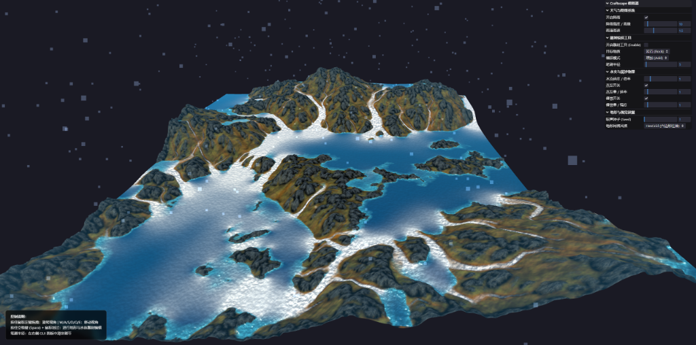

# Craftscape Three.js 🌊⛰️

[English](./README.md) | 简体中文

> 基于 **Three.js** 与 **WebGL GPGPU 浅水物理学** 的高自由度三维地形生成、差异化土体侵蚀与山洪仿真沙盘。
> 本项目重构并大幅扩展自 Florian Boesch 的经典 WebGL 引擎 [pyalot/craftscape](https://github.com/pyalot/craftscape)。

[](https://threejs.org/)
[](https://vitejs.dev/)
[](https://pnpm.io/)
[](LICENSE)



---

## 📖 项目简介

**Craftscape Three.js** 是一个运行于浏览器端的实时三维流域与山洪模拟沙盘。系统通过多 Pass 浮点 FBO 离屏计算管线（`TerrainSim`、`WaterSim`）与质量守恒的虚拟管道（Virtual Pipe）浅水方程，在高达 60 FPS 的帧率下实时模拟多尺度地貌演化、黄土湿陷沉降、红壤急流切沟、多水源山洪暴发、局地强暴雨汇流及交互式地形雕刻。

---

## ✨ 新增核心功能与作用介绍

### 1. 🗺️ 多尺度地貌面积与模拟精度解耦（`1×1` ~ `16×16 km`）
* **大面积流域生成（`1 ~ 256 km²`）**：支持 `1×1`、`2×2`、`4×4`、`8×8`、`16×16` 一键切换及 `1 ~ 16 km` 任意整数自定义边长，自动联动缩放垂直高程比例（`size^0.48`）、全景镜头距离、雨区覆盖与大气雾效。
* **地貌尺度倍率（`0.50 – 3.00`）**：自由控制大面积扩展策略——低倍率呈现连绵群山与多级支沟大流域，高倍率可拉宽单一峡谷河道。
* **GPU 模拟精度三档切换（`512 / 1024 / 2048`）**：面积与计算精度解耦，切换 `4×4` 及以上面积时自动切至 `1024 高清`，并支持手动切换 `512 流畅 / 1024 高清 / 2048 超清`（带完整 FBO 资源释放，无显存泄漏）。
* **轻量化索引网格与高速缓存**：将网格重构为 `Uint32Array` 索引化 `GridGeometry`（顶点数降低 6 倍），并采用 `256×256` 降采样 CPU 高程缓存实现毫秒级精准射线拾取与标记贴地。

### 2. ⛰️ 真实航拍 DEM 风格程序化地貌
* **6 类典型地貌预设模板**：
  * **丘陵宽谷峡道 (`canyon`)**：圆润山体夹持天然河谷，黏性坡壁耐塌陷、急流专注切沟。
  * **黄土树枝沟壑 (`dendritic`)**：多条上游支沟向主河槽汇流，过水触发不均匀湿陷沉降与泥沙涌流。
  * **蜿蜒河漫滩 (`meander`)**：宽缓 S 型河谷与阶地，兼顾谷底粉砂沉降与山坡红壤切沟。
  * **出山口冲积扇 (`alluvial`)**：山前峡口接入开阔冲积扇平原，砾石砂土抗沉降、冲出宽浅河槽。
  * **梯级蓄水盆地 (`dammed`)**：上游山谷汇入天然拦水盆地，漫溢垭口后在下游演进。
  * **连绵丘陵山系 (`ridges`)**：典型卫星 DEM 中低山连绵起伏，带自然汇水坡降。
* **无针刺平滑地形与水力预侵蚀**：淘汰尖锐锯齿噪声，改用平滑双曲山脊（`softAbs`）与柔和多倍频丘陵骨架，并在生成后执行 2 遍 3×3 微风化平滑（`createSmoothTerrainMaterial`）；支持全部地貌参数滑块微调与 **80 步分帧水力预侵蚀** 一键冲刷出自然冲沟。

### 3. 🪨 逐像素地质土体系统与差异化冲刷
* **石土比例与地层预设**：支持调节 **泥土占比（`0% ~ 100%`）**、**表层覆土厚度**、**陡坡裸岩阈值**、**石土斑块扰动**，并内置 3 套地层快捷预设（`强岩硬谷地层`、`黏性红壤切沟地层`、`湿陷黄土沟壑地层`）。
* **4 类差异化土体模型（`GeologyMapShader`）**：逐像素生成 `(subsidence, incision, cohesion, soilTypeId)` 地质属性图：
  * **湿陷黄土**：干态静止；过水浸润后产生不均匀湿陷沉降与坡脚滑塌（内置硬质钙质抗沉降斑块）。
  * **黏性红壤**：高黏聚力高休止角，遇水坡壁稳固不塌，急流冲刷只向下切出清晰深邃的沟壑。
  * **砂砾冲积**：粗粒透水抗塌抗沉降，山洪过境仅在表层冲出宽浅砾石河槽。
  * **复合流域**：同一流域内自然分带——谷底粉砂沉降、山坡红壤切沟、高脊风化岩砾抗冲。
* **干态绝对静止与独立物理调控**：无水区域泥土 100% 保持静止、绝不自行融化沉降；仅在过水或受浸润后按所在位置的土体属性差异化响应，并支持单独调节 **基岩抗冲硬度**、**泥土易蚀度** 与 **湿土坡面滑移率**。

### 4. 🌊 质量守恒浅水管道物理与山洪模拟
* **Virtual Pipe 浅水方程解算**：采用严格质量守恒的 4 向虚拟管道出流模型，支持 `1 ~ 4` 倍物理子步加速（`Substeps`）、水流速度倍率调控，以及 **开放边界自由排水 / 封闭蓄水盆地** 切换。
* **最多 24 个 3D 交互水源点（`WaterSources` & `SourceMarkers`）**：支持在 3D 地形上直接点击放置、选中、开关或删除水源点，每个水源可独立调节流量、出流半径，并切换 **持续来水** 或 **待命洪峰** 模式；大面积流域自动在多条支沟源头布设默认水源。
* **一键触发山洪洪峰**：支持全流域或单点触发山洪脉冲（1.5 秒快速起涨 → 2.5 秒洪峰维持 → 8 秒指数退水），还原真实山洪演进过程。
* **全局降雨与局地强暴雨区**：支持全局降雨强度/落速调节，以及点击/拖拽布设 **局地强暴雨区**，实时联动 3D 雨滴粒子（`RainParticles`）向暴雨中心聚集倾泻。
* **悬浮泥沙浑浊渲染与无尖刺岸线**：物理追踪水体悬浮泥沙浓度与地表湿润度，清水呈透亮青蓝，携沙山洪呈浑浊黄褐色并翻涌泥沫；`WaterDisplayShader` 顶点采用湿纹素过滤采样，彻底消除陡峭河岸边的梳齿状渲染尖刺。

### 5. 🧊 立体地质切面沙盘、地质分布视图与定制 HUD
* **立体沙盘地质切面裙边（`SkirtGeometry` & `SkirtShader`）**：沙盘四周自带垂直地质剖面，直观显示沉积基岩纹理与随土体类型变化的表土厚薄。
* **写实航拍视图 & 地质土体视图一键切换**：支持卫星航拍光影（含新切沟壑壁面、暗湿沉降区、下游淤积粉砂对比）与 **地质土体分布视图**（四色专题图 + 左上角悬浮图例）实时切换。
* **现代化悬浮 HUD 与配置导入导出**：包含左上角状态遥测条（模式提示、幅员与网格精度、实时 FPS、水源数、洪峰倒计时）、底部快捷工具栏、右侧 4 标签可折叠控制面板（`地形地貌 / 石土材质 / 水源降雨 / 物理场景`），以及场景参数 **JSON 导出 / 导入**。

---

## 🛠️ 技术栈

* **核心渲染与 GPGPU**: [Three.js](https://threejs.org/) (WebGL / `RGBAFloat` 离屏 FBO)
* **构建工具**: [Vite 6.x](https://vitejs.dev/)
* **包管理器**: [pnpm](https://pnpm.io/)
* **着色器**: GLSL（多 Pass 物理模拟 + 3D 光线步进拾取）
* **交互界面**: 零依赖定制毛玻璃悬浮 HUD（`HudController.js`）

---

## 🚀 快速开始

```bash
# 1. 克隆仓库
git clone https://github.com/feng62/craftscape-threejs.git
cd craftscape-threejs

# 2. 安装依赖
pnpm install

# 3. 启动开发服务器
pnpm dev

# 4. 构建生产版本
pnpm build
```

---

## 🎮 操作指南

| 操作 / 快捷键 | 响应说明 |
| :--- | :--- |
| **浏览视角 (`1`)** | 鼠标左键拖拽旋转视角，右键拖拽平移，滚轮缩放 |
| **放置水源 (`2`)** | 左键点击地形新增水源点或选中已有 3D 水源标记；右键拖拽旋转视角 |
| **局地暴雨 (`3`)** | 左键点击或拖拽地形实时移动并开启局地强暴雨中心；右键拖拽旋转视角 |
| **地形雕刻 (`4`)** | 左键拖拽（或在任意模式下按住 `Space` 空格键）增减岩石、泥土或水体；右键旋转 |
| **`W / A / S / D / Q / E`** | 前后左右及上下移动相机观察位置（移动速度随地图面积自适应） |
| **底部快捷操作栏** | 触发山洪、切换地质视图、暂停/继续、清空水体、重置地形、重置全景视角 |

---

## 🏛️ 项目结构

```text
craftscape-threejs/
├── public/
│   ├── preview.png
│   └── textures/                  # 岩石与草地贴图及法线资源
├── src/
│   ├── config/
│   │   └── presets.js             # 6 类地貌预设、4 类土体模型、3 套地层预设
│   ├── controls/
│   │   └── SculptController.js    # 交互模式切换、快捷键与雕刻状态控制
│   ├── effects/
│   │   ├── RainParticles.js       # 3D 雨滴粒子系统（支持全局降雨与局地暴雨聚集）
│   │   └── SourceMarkers.js       # 3D 水源点浮标与局地暴雨范围光环
│   ├── geometries/
│   │   ├── GridGeometry.js        # Uint32Array 索引化轻量化地形/水面网格
│   │   ├── HexGridGeometry.js     # 六边形柱体风格网格
│   │   └── SkirtGeometry.js       # 立体沙盘四周地质切面裙边几何体
│   ├── shaders/
│   │   ├── TerrainGenShader.js    # 多尺度航拍 DEM 地貌生成器与 3×3 微风化平滑
│   │   ├── GeologyMapShader.js    # 逐像素地质属性图生成器
│   │   ├── ErrodeShader.js        # 差异化急流切沟与有界泥沙搬运
│   │   ├── DiffuseSoilShader.js   # 干态绝对静止、湿态黏聚滑移与湿陷压实沉降
│   │   ├── GodShader.js           # 3D 光线步进地形雕刻着色器
│   │   ├── NormalShader.js        # 世界尺度地形法线与环境光遮蔽 (AO)
│   │   ├── WaterShaders.js        # Virtual Pipe 通量、平流、多水源、暴雨与开放边界
│   │   ├── DisplayShader.js       # 写实航拍地貌渲染与地质分布视图着色器
│   │   ├── WaterDisplayShader.js  # 湿纹素岸线采样、浑浊泥沙与浪花渲染
│   │   └── SkirtShader.js         # 沙盘地质剖面岩层与表土渲染着色器
│   ├── simulation/
│   │   ├── GPGPUProcessor.js      # WebGLRenderTarget 离屏计算封装
│   │   ├── TerrainSim.js          # 地形管线、256×256 CPU 高程缓存与射线拾取
│   │   ├── WaterSim.js            # 多子步 Virtual Pipe 浅水物理解算器
│   │   └── WaterSources.js        # 多水源管理与山洪洪峰包络演进
│   ├── ui/
│   │   └── HudController.js       # 4 标签毛玻璃 HUD、实时遥测与 JSON 导入导出
│   ├── style.css                  # 全局暗色主题与 HUD 样式
│   └── main.js                    # 场景入口、主循环与多尺度/多分辨率动态重建
├── index.html
├── package.json
└── vite.config.js
```

---

## 🙏 致谢与参考

* 感谢 **Florian Boesch** 原作者创作的 [pyalot/craftscape](https://github.com/pyalot/craftscape) WebGL 经典项目。

---

## 📄 开源协议

本项目基于 [AGPL-3.0 License](LICENSE) 协议开源。
